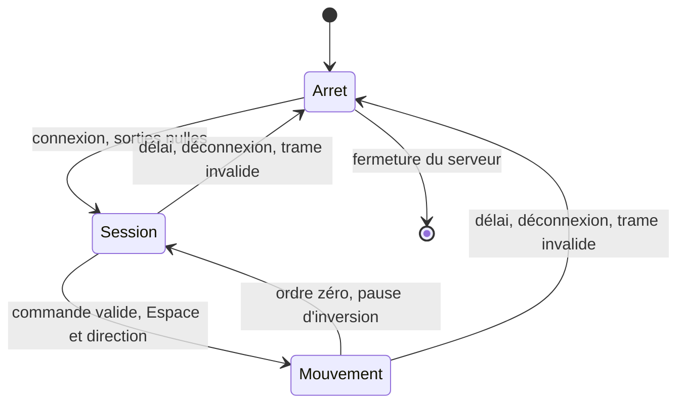

# Protocole et arrêt — Drone V2

> Étude reportée, hors version active ; voir le [statut de l’archive][statut-archive].

TCP IPv4, port initial 8765, un pilote servi à la fois.
Trame JSON ASCII terminée par retour à la ligne ; buffer maximal 1024 octets, TCP_NODELAY.
Ticket aléatoire de 128 bits à la connexion, renouvelé après chaque commande.
Le client attend l’accusé avant la suivante : un seul message en attente.

| Champ | Règle |
| --- | --- |
| v | Entier 1 |
| seq | Entier croissant, au plus 2 puissance 53 |
| ticket | Dernier ticket de la session courante |
| enabled | Booléen ; false désactive toujours les moteurs |
| throttle | Nombre fini de -1 à 1 ; positif = avant |
| turn | Nombre fini de -1 à 1 ; positif = droite |
| mac | HMAC-SHA256 hexadécimal avec clé partagée |

HMAC sur tous les autres champs : JSON trié par clé, sans espaces, sans NaN.
Ancienne séquence, ticket périmé, valeur hors domaine ou signature invalide : arrêt et fermeture.
Réponse : ticket, seq, timeout_s, left, right et enabled ; sorties logicielles, pas mesures.
L’authentification ne chiffre pas les échanges ; utiliser le réseau local prévu.

## États

Le délai de 300 ms utilise l’horloge monotone serveur. Seule une commande valide
reçue avant l’échéance le renouvelle. Une ligne partielle ne maintient pas le mouvement.
À expiration : session fermée. Toute reconnexion commence par un ordre d’arrêt.
Le Mac envoie environ 20 commandes/s, attend au plus 120 ms par réponse,
et exige une reconnexion manuelle après erreur.

Mixage : gauche = throttle + turn ; droite = throttle - turn.
Normaliser si l’amplitude dépasse 1, appliquer max_duty et les inversions de roue configurées.
Après inversion, les deux ponts sont désactivés au moins 50 ms.
La reprise exige des ordres réguliers ; nSLEEP est activé 2 ms avant les sorties.
L’arrêt désactive les ponts en roue libre, sans freinage électrique.

## Limites à mesurer

Attente réseau de 20 ms, ordonnancement et traitement GPIO s’ajoutent au délai configuré.
Mesurer le délai électrique et la distance de roulage sur le vrai robot.
SIGINT/SIGTERM arrêtent et libèrent les GPIO. Gel complet, SIGKILL et panne Linux
ne sont pas couverts par cette boucle ; V10 reste à réaliser.
Évaluer les rappels du module et une éventuelle coupure indépendante au banc.

[statut-archive]: ../README.md
