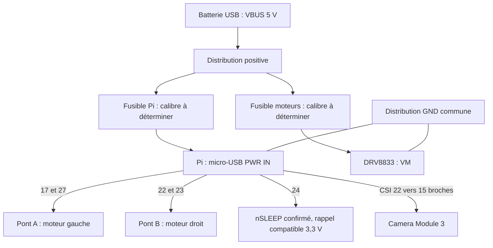

# Schéma de câblage — Drone V2

**Proposition à confirmer sur le module livré.** Pas de carte électronique à fabriquer.
Raccordements USB et fusibles à contrôler avant alimentation ; brochage candidat en BCM.

## Nomenclature du faisceau

| ID | Départ | Arrivée | Contrôle |
| --- | --- | --- | --- |
| E01 | USB-A VBUS | Distribution +5 V | Repérage par continuité |
| E02 | USB-A GND | Distribution GND | Retour principal |
| E03 | +5 V | Fusible Pi puis micro-USB VBUS | Alimente PWR IN |
| E04 | GND | micro-USB GND | Retour Pi |
| E05 | +5 V | Fusible moteur puis VM | Source moteur |
| E06 | GND | DRV8833 GND | Retour moteur |
| E07 | Pi GND physique 6 | DRV8833 GND logique | Masse commune |
| E08 | Pi BCM17 / physique 11 | AIN1 confirmé | Commande gauche avant |
| E09 | Pi BCM27 / physique 13 | AIN2 confirmé | Commande gauche arrière |
| E10 | Pi BCM22 / physique 15 | BIN1 confirmé | Commande droite avant |
| E11 | Pi BCM23 / physique 16 | BIN2 confirmé | Commande droite arrière |
| E12 | Pi BCM24 / physique 18 | nSLEEP confirmé | Autorisation des ponts |
| E13 | AOUT1 et AOUT2 | Moteur gauche | Polarité à essayer |
| E14 | BOUT1 et BOUT2 | Moteur droit | Polarité à essayer |

E07 établit la référence logique ; les courants moteurs ne doivent pas traverser les pastilles Pi.
Acheminer E05/E06 directement entre distribution et pilote. Garder les boucles moteurs courtes.
Relever les longueurs après implantation et choisir la section selon courant et chute admissible.
Le fil 22 AWG de la liste est une fourniture prévue, pas un dimensionnement déjà validé.

## Réalisation

Conserver USB-A côté batterie et micro-USB côté Pi sur les deux moitiés d’un câble.
Repérer VBUS/GND par mesure ; la couleur seule n’est pas une preuve.
Les conducteurs de données coupés sont isolés séparément.
Souder, gainer chaque jonction puis immobiliser le faisceau avec accès aux fusibles.
Mesurer continuité, isolement entre réseaux, polarité et tension avant connexion des cartes.
Les soudures directes Pi exigent maintien mécanique et absence de traction sur les pastilles.

nFAULT n’est pas commandé par le Pi dans cette version. Une sortie nFAULT du module reste
isolée si inutilisée ; contrôler qu’aucun pont ou rappel 5 V n’atteint les signaux Pi.
EEP/ULT dans l’annonce ne suffit pas à identifier une borne.
Ne pas alimenter le DRV8833 depuis le 5 V de la barrette Pi.
Pour couper physiquement, conserver la prise de la batterie accessible.

## Points non dimensionnés

Calibres des deux fusibles, sections/longueurs, tenue du port USB, courants moteurs,
température du pilote et compléments de découplage : voir les [relevés](releves.md).
Les condensateurs et résistances restent conditionnels après inspection du module.
La [notice TI](https://www.ti.com/lit/ds/symlink/drv8833.pdf) décrit la puce, pas ce module vendeur.
