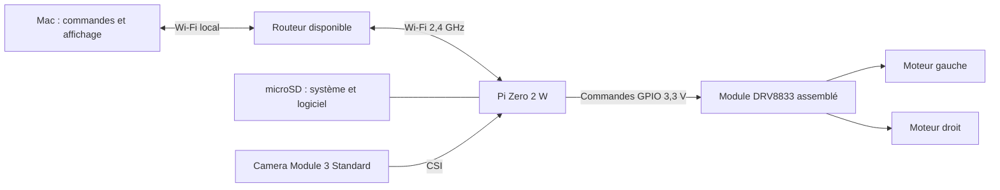

# Architecture — Drone terrestre V2

Version active rétablie le **12 octobre 2026** : moteurs TT et batterie USB 5 V.
Vitesse maximale estimée environ 2,2 km/h ; essais initiaux à PWM 35 %.

Conception de départ issue de V5, avec composants du commerce et montage intérieur.
Les références, prix datés et décisions d’achat sont dans [achats.json](achats.json).
Le Pi et la caméra conservent la base informatique initiale ; le châssis est un kit équipé.
Le pilotage est écrit et testé hors matériel. Assemblage, caméra, alimentation et mécanique
restent à valider sur le prototype.

Le Pi acquiert la caméra et diffuse une cible H.264 720p30 en MPEG-TS/UDP vers ffplay.
Les commandes passent par TCP 8765, avec clé partagée et délai initial 300 ms.
La vidéo utilise UDP 5000 et des processus séparés du serveur moteur.
L’arrêt sur perte de commande est testé en simulation ; le gel complet du serveur reste à étudier.
Le système prévu est Raspberry Pi OS Lite, sur microSD 16 Go sans enregistrement vidéo.
Utiliser la pile caméra rpicam/libcamera ; raspivid ne prend pas en charge la Camera Module 3.
La caméra nécessite une nappe 15 vers 22 broches adaptée au Pi Zero.

## Énergie et mécanique

La batterie USB fournit le 5 V à deux branches protégées : Pi/caméra et pilote/moteurs.
Le Pi est alimenté par PWR IN, pas par une broche de commande.
Les masses sont communes ; les pointes moteurs partagent la même source avec la vidéo.
L’annonce 3 A ne garantit pas les démarrages simultanés : mesurer les tensions et courants.
La recharge est prévue séparément depuis le Mac ; ne pas supposer une fonction pass-through.

Le châssis DollaTek regroupe plaque, motoréducteurs, roues et fixations.
La roulette visible sur sa photo doit être confirmée dans le contenu réel du lot.
Les capteurs d’encodeur et les piles AA ne sont pas prévus.
La caméra regarde vers l’avant ; supports et nappe sont proposés dans la maquette d’assemblage.
Le montage définitif reste à confirmer après mesure et contrôle des fixations.
Positionner la batterie bas, conserver accès aux prises et immobiliser les fils.

## Pas de carte électronique sur mesure

Pi et DRV8833 sont des cartes déjà assemblées. Le travail électronique est le câblage.
Les condensateurs et résistances supplémentaires sont à confirmer après inspection et essais.
Leurs lots restent chiffrés dans la référence V5, sans obligation de tout monter ou acheter.
La carte Pi seule n’inclut pas de barrette GPIO ; des soudures directes sont prévues.
La capacité de soudure et le maintien des fils doivent être confirmés au fablab.

Voir le [câblage détaillé](Electronique/README.md), l’[implantation](Mecanique/README.md),
le [montage](Assemblage/README.md), le [logiciel](Logiciel/README.md)
et les [essais](Validation/README.md).

## Sources techniques de la conception

- [Raspberry Pi Zero 2 W officiel][pi]
- [Installation des caméras et nappes Raspberry Pi][camera]
- [Logiciel caméra Raspberry Pi][logiciel]
- [Notice TI DRV8833][ti]

[pi]: https://www.raspberrypi.com/products/raspberry-pi-zero-2-w/
[camera]: https://www.raspberrypi.com/documentation/accessories/camera.html
[logiciel]: https://www.raspberrypi.com/documentation/computers/camera_software.html
[ti]: https://www.ti.com/lit/ds/symlink/drv8833.pdf
